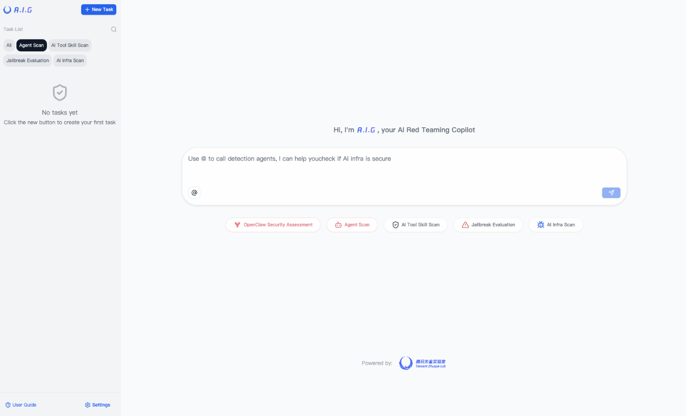
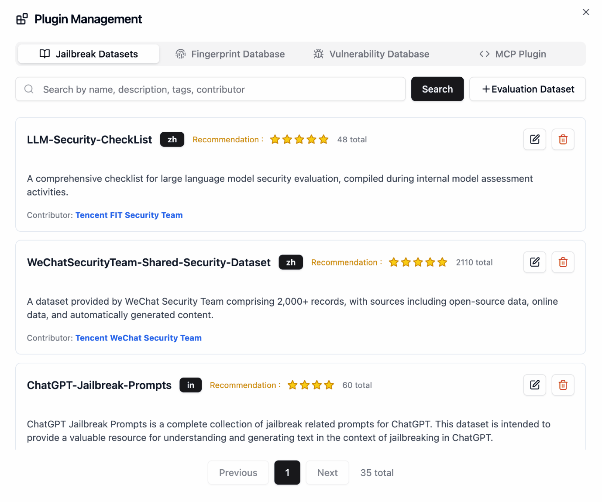
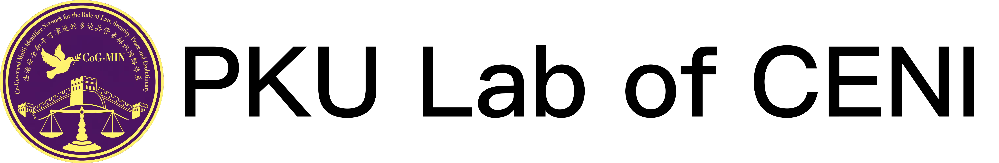
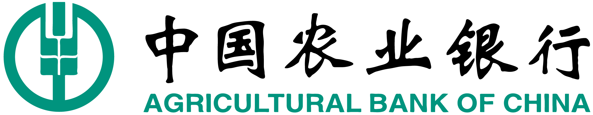
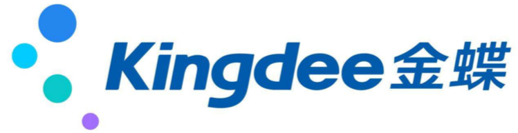
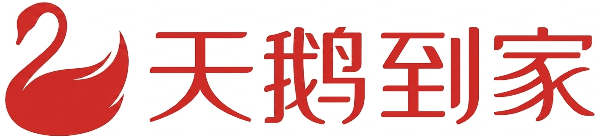

<p align="center">
    <h1 align="center"></h1>
</p>
<p align="center">
  <a href="https://tencent.github.io/AI-Infra-Guard/">📖 Documentation</a> &nbsp;|&nbsp;
  🌐 <b>🇬🇧 English</b> · <a href="./readme/README_ZH.md">🇨🇳 中文</a>
</p>
<p align="center">
    <a href="https://github.com/tencent/AI-Infra-Guard/stargazers">
      
    </a>
    <a href="https://github.com/Tencent/AI-Infra-Guard">
        
    </a>
    <a href="https://github.com/Tencent/AI-Infra-Guard">
        
    </a>
    <a href="https://github.com/Tencent/AI-Infra-Guard">
        
    </a>
</p>
<p align="center">
    <a href="https://clawhub.ai/aigsec/edgeone-clawscan" target="_blank">
       
    </a>
    <a href="https://clawhub.ai/aigsec/edgeone-skill-scanner" target="_blank">
       
    </a>
    <a href="https://clawhub.ai/aigsec/aig-scanner" target="_blank">
       
    </a>
</p>
<p align="center">
    <a href="https://github.com/openclaw/clawscan" target="_blank">
       
    </a>
</p>
<p align="center">
  <a href="https://trendshift.io/repositories/13637" target="_blank"><picture><source media="(prefers-color-scheme: dark)" srcset="https://trendshift.io/api/badge/repositories/13637"><source media="(prefers-color-scheme: light)" srcset="https://trendshift.io/api/badge/repositories/13637"></picture></a>&nbsp;
  <a href="https://www.blackhat.com/eu-25/arsenal/schedule/index.html#aigai-infra-guard-48381" target="_blank"></a>&nbsp;
  <a href="https://github.com/deepseek-ai/awesome-deepseek-integration" target="_blank"></a>
</p>

<br>

<p align="center">
    <h3 align="center">🚀 One-Stop AI Red Teaming Platform by Tencent Zhuque Lab</h3>
</p>

<b>A.I.G (AI-Infra-Guard)</b> brings together OpenClaw security checks, Agent security scanning, AI tool and skill scanning, AI infrastructure vulnerability scanning, and LLM security assessment (jailbreak evaluation), aiming to provide the most comprehensive, intelligent, and easy-to-use way to check AI security risks.

<p>
  We are committed to making A.I.G(AI-Infra-Guard) the industry-leading AI red teaming platform. More stars help this project reach a wider audience, attracting more developers to contribute, which accelerates iteration and improvement. Your star is crucial to us!
</p>
<p align="center">
  <a href="https://github.com/Tencent/AI-Infra-Guard">
      
  </a>
</p>

<br>

## Table of Contents
- [🚀 Quick Start](#-quick-start)
- [🧰 Standalone Use](#-standalone-use)
- [🖼️ Showcase](#️-showcase)
- [📖 User Guide](#-user-guide)
- [🏗️ Architecture Evolution](./docs/architecture_evolution.md)
- [📝 Contribution Guide](#-contribution-guide)
- [🛡️ About the Team](#️-about-the-team)
- [🙏 Acknowledgements](#-acknowledgements)
- [💬 Join the Community](#-join-the-community)
- [📖 Citation](#-citation)
- [📄 License](#-license)
<br><br>
## 🚀 Quick Start
### 🐳 Deploy A.I.G with Docker

| Docker | RAM | Disk Space |
|:-------|:----|:----------|
| 20.10 or higher | 4GB+ | 10GB+ |

```bash
# This method pulls pre-built images from Docker Hub for a faster start
git clone https://github.com/Tencent/AI-Infra-Guard.git
cd AI-Infra-Guard
# For Docker Compose V2+, replace 'docker-compose' with 'docker compose'
docker-compose -f docker-compose.images.yml up -d
```

Once the service is running, you can access the A.I.G web interface at:
`http://localhost:8088`
<br>


### Other Installation Methods

**Method 2: One-Click Install Script （Recommended）**
```bash
# This method will automatically install Docker and launch A.I.G with one command
curl https://raw.githubusercontent.com/Tencent/AI-Infra-Guard/refs/heads/main/docker.sh | bash
```

**Method 3: Build and run from source**
```bash
git clone https://github.com/Tencent/AI-Infra-Guard.git
cd AI-Infra-Guard
# This method builds a Docker image from local source code and starts the service
# (For Docker Compose V2+, replace 'docker-compose' with 'docker compose')
docker-compose up -d
```

Note: The AI-Infra-Guard project is positioned as an AI red teaming platform for internal use by enterprises or individuals. It currently lacks an authentication mechanism and should not be deployed on public networks.

For more information, see: [https://tencent.github.io/AI-Infra-Guard/?menu=getting-started](https://tencent.github.io/AI-Infra-Guard/?menu=getting-started)

## 🧰 Standalone Use

The five scanners can be used from the command line without starting the web service. Only the shortest usage is shown below. See each README for parameters and examples.

### AI Infrastructure Scan

Scan a domain, IP, or URL and match fingerprints and vulnerabilities.

```bash
pip install aig-infra-scan
aig-infra-scan -t https://example.com
```

[View README](./infra-scan/README.md)

### LLM Security Assessment / Jailbreak

Evaluate a model that exposes an OpenAI-compatible API.

```bash
pip install aig-model-scan
aig-model-scan \
  --model "gpt-4o-mini" \
  --base_url "https://api.openai.com/v1" \
  --api_key "your-api-key" \
  --max_concurrent 10 \
  --scenarios Bias \
  --techniques Raw
```

[View README](./AIG-PromptSecurity/README.md)

### MCP Scan

Scan an MCP server source directory, or connect to a service that is already running.

```bash
pip install aig-mcp-scan
export LLM_API_KEY="your-api-key"
aig-mcp-scan --repo /path/to/mcp-server -o result.sarif.json
```

[View README](./mcp-scan/README.md)

### Skill Scan

Audit a local Agent Skill directory.

```bash
pip install aig-skill-scan
export LLM_API_KEY="your-api-key"
aig-skill-scan --repo /path/to/your/skill -o result.sarif.json
```

[View README](./skill-scan/README.md)

### Agent Scan

Send test prompts to a running Agent. `target.yaml` describes the Agent under test. The API key is for the model used by the scanner.

```bash
pip install aig-agent-scan
export LLM_API_KEY="your-api-key"
aig-agent-scan --agent_provider target.yaml -o result.json
```

[View README](./agent-scan/README.md)

## 🖼️ Showcase

### A.I.G Main Interface




<br />

## 📖 User Guide

Visit our online documentation: [https://tencent.github.io/AI-Infra-Guard/](https://tencent.github.io/AI-Infra-Guard/)

For more detailed FAQs and troubleshooting guides, visit our [documentation](https://tencent.github.io/AI-Infra-Guard/?menu=faq).
<br />
<br>

## 📝 Contribution Guide

One of A.I.G's core strengths is its rich plugin system, which can be configured quickly. We welcome high-quality plugins and features from the community.

### Plugin Contribution Rules
1.  **Fingerprint Rules**: Add new YAML fingerprint files to the `data/fingerprints/` directory.
2.  **Vulnerability Rules**: Add new vulnerability scan rules to the `data/vuln/` directory.
3.  **MCP Plugins**: Add new MCP security scan rules to the `data/mcp/` directory.
4.  **Model Evaluation Datasets**: Add new model evaluation datasets to the `data/eval` directory.

Please refer to the existing rule formats, create new files, and submit them via a Pull Request.

### Other Ways to Contribute
- 🐛 [Report a Bug](https://github.com/Tencent/AI-Infra-Guard/issues)
- 💡 [Suggest a New Feature](https://github.com/Tencent/AI-Infra-Guard/issues)
- ⭐ [Improve Documentation](https://github.com/Tencent/AI-Infra-Guard/pulls)
<br />
<br />

## 🛡️ About the Team

This project is led and developed by **Tencent Zhuque Lab**, part of the Tencent Security Platform Department. Founded in 2019, [Tencent Zhuque Lab](https://matrix.tencent.com/) is a top-tier security research lab focused on real-world offensive and defensive research and frontier technology in the AI security space, covering large model security, AI agent security, AI-empowered security, and AI-generated content detection.

The team has helped major vendors such as **NVIDIA, Google, and Microsoft**, as well as open-source communities like **OpenClaw, Linux, and Hugging Face**, fix a large number of high-risk vulnerabilities, and has been publicly acknowledged by them.

We have released open-source AI security products including the AI Red Team Security Testing Platform <b>A.I.G (AI-Infra-Guard)</b> and the **Zhuque AI Detection Assistant**. Our research has been widely published at top international security and AI conferences such as **Black Hat, DEF CON, ICLR, CVPR, NeurIPS, and ACL**, and we have authored the book *"AI Security: Technology and Practice"*.

### 👥 Core Members & Contributions

| Role | Member | Contribution |
| --- | --- | --- |
| Head of Tencent Security Platform Department | **Yong Yang** | Initiated A.I.G and proposed automated assessment of AI agent loss-of-control risks, guiding the platform's expansion from AI infrastructure vulnerability scanning to agent execution risk, tool misuse, and permission-boundary evaluation. |
| Head of Tencent Zhuque Lab | **Xing Zheng** | Proposed the automated vulnerability-update and benchmark-alignment mechanism, helping AI Infra fingerprints, CVE/GHSA rules, and benchmarks iterate continuously. |
| Project Lead | **Nicky** | Frontier security research, product planning, technical-route decisions, internal and external collaboration, and communications. |
| Technical Lead | **Python** | Overall architecture design, core module development, and version iteration. |
| Core Contributor | **Zona** | Frontend interaction, product experience, community operations, and user-feedback loop. |
| Core Contributor | **Fyoung** | AI Infra vulnerability component fingerprint updates and Benchmark system construction. |
| Core Contributor | **Xiangfan** | Security capability development for Skill risks and agent loss-of-control scenarios. |
| Core Contributor | **Elwood** | Enhancing Agent security scanning capabilities and updating technical reports. |
| Core Contributor | **Robert** | LLM safety assessment and jailbreak-evaluation strategy operations. |
| Core Contributor | **Zoe** | LLM safety assessment, jailbreak evaluation, and model-integration module development. |
| Contributor | **Ronin** | Participated in AI agent security scanning development. |
| Contributor | **Rsin** | Participated in community operations and campaign communications. |

<br />

## 🙏 Acknowledgements

### 🎓 Academic Collaborations

We thank our academic partners for their research contributions and technical support.

#### 
<table>
  <tr>
    <td align="center" width="90">
      <a href="#">
        
      </a>
      <br />
      <a href="#">
        <sub><b>Prof.&nbsp;hui&nbsp;Li</b></sub>
      </a>
    </td>
    <td align="center" width="90">
      <a href="https://github.com/TheBinKing">
        
      </a>
      <br />
      <a href="mailto:1546697086@qq.com">
        <sub><b>Bin&nbsp;Wang</b></sub>
      </a>
    </td>
    <td align="center" width="90">
      <a href="https://github.com/KPGhat">
        
      </a>
      <br />
      <a href="mailto:kpghat@gmail.com">
        <sub><b>Zexin&nbsp;Liu</b></sub>
      </a>
    </td>
    <td align="center" width="90">
      <a href="https://github.com/GioldDiorld">
        
      </a>
      <br />
      <a href="mailto:g.diorld@gmail.com">
        <sub><b>Hao&nbsp;Yu</b></sub>
      </a>
    </td>
    <td align="center" width="90">
      <a href="https://github.com/Jarvisni">
        
      </a>
      <br />
      <a href="mailto:719001405@qq.com">
        <sub><b>Ao&nbsp;Yang</b></sub>
      </a>
    </td>
    <td align="center" width="90">
      <a href="https://github.com/Zhengxi7">
        
      </a>
      <br />
      <a href="mailto:linzhengxi7@126.com">
        <sub><b>Zhengxi&nbsp;Lin</b></sub>
      </a>
    </td>
  </tr>
</table>

#### 

<table>
  <tr>
    <td align="center" width="120">
      <a href="https://yangzhemin.github.io/">
        
      </a>
      <br />
      <a href="mailto:yangzhemin@fudan.edu.cn">
        <sub><b>Prof.&nbsp;Zhemin&nbsp;Yang</b></sub>
      </a>
    </td>
    <td align="center" width="100">
      <a href="https://github.com/kangwei-zhong">
        
      </a>
      <br />
      <a href="mailto:kwzhong23@m.fudan.edu.cn">
        <sub><b>Kangwei&nbsp;Zhong</b></sub>
      </a>
    </td>
    <td align="center" width="90">
      <a href="https://github.com/MoonBirdLin">
        
      </a>
      <br />
      <a href="mailto:linjp23@m.fudan.edu.cn">
        <sub><b>Jiapeng&nbsp;Lin</b></sub>
      </a>
    </td>
    <td align="center" width="90">
      <a href="https://vanilla-tiramisu.github.io/">
        
      </a>
      <br />
      <a href="mailto:csheng25@m.fudan.edu.cn">
        <sub><b>Cheng&nbsp;Sheng</b></sub>
      </a>
    </td>
  </tr>
</table>
<br>

### 👥 Thanks to the following teams and developers
<br />
<table style="border: none; border-collapse: inherit;">
  <tr>
    <td width="33%" style="border: none;"></td>
    <td width="33%" style="border: none;"></td>
    <td width="33%" style="border: none;"></td>
  </tr>
</table>
<a href="https://github.com/Tencent/AI-Infra-Guard/graphs/contributors">
  
</a>
<br>
<br>

### 🤝 Thanks to the following organizations and teams for using and supporting A.I.G

<br>
<div align="center">









</div>

<div align="center">


</div>

<br>
<br>

## 💬 Join the Community

### 🌐 Online Discussions
- **GitHub Discussions**: [Join our community discussions](https://github.com/Tencent/AI-Infra-Guard/discussions)
- **Issues & Bug Reports**: [Report issues or suggest features](https://github.com/Tencent/AI-Infra-Guard/issues)

### 📱 Discussion Community
<table>
  <thead>
  <tr>
    <th>WeChat Group</th>
  </tr>
  </thead>
  <tbody>
  <tr>
    <td></td>
  </tr>
  </tbody>
</table>

### 📧 Contact Us
For collaboration inquiries or feedback, please contact us at: [zhuque@tencent.com](mailto:zhuque@tencent.com)

### 🔗 More Security Tools
If you are interested in code security, we recommend [A.S.E (AICGSecEval)](https://github.com/Tencent/AICGSecEval), the industry's first project-level AI-generated code security evaluation framework open-sourced by the Tencent Wukong Code Security Team.


<br>
<br>

## 📖 Citation

If you use A.I.G in your research or product, please cite:

```bibtex
@misc{Tencent_AI-Infra-Guard_2025,
  author={{Tencent Zhuque Lab}},
  title={{AI-Infra-Guard: A Comprehensive, Intelligent, and Easy-to-Use AI Red Teaming Platform}},
  year={2025},
  howpublished={GitHub repository},
  url={https://github.com/Tencent/AI-Infra-Guard}
}
```
<br>

## 📄 License

This project is open-sourced under the **Apache License 2.0**. See the [LICENSE](./LICENSE) file for details.

## ⚖️ License & Attribution

This project is open-sourced under the **Apache License 2.0**. We warmly welcome and encourage community contributions, integrations, and derivative works, subject to the following attribution requirements:

1. **Retain notices**: You must retain the `LICENSE` and `NOTICE` files from the original project in any distribution.
2. **Product attribution**: If you integrate AI-Infra-Guard's core code, components, or scanning engine into your open-source project, commercial product, or internal platform, you must clearly state the following in your **product documentation, usage guide, or UI "About" page**:
   > "This project integrates [AI-Infra-Guard](https://github.com/Tencent/AI-Infra-Guard), open-sourced by Tencent Zhuque Lab."
3. **Academic & article citation**: If you use this tool in vulnerability analysis reports, security research articles, or academic papers, please explicitly mention "Tencent Zhuque Lab AI-Infra-Guard" and include a link to the repository.

Repackaging this project as an original product without disclosing its origin is strictly prohibited.

<div>

<a href="https://www.star-history.com/?type=date&repos=Tencent%2FAI-Infra-Guard">
 <picture>
 <source media="(prefers-color-scheme: dark)" srcset="https://api.star-history.com/chart?repos=Tencent/AI-Infra-Guard&type=date&theme=dark&legend=top-left&sealed_token=3aux6V5PKs5SBSuoVgw6MReXo5IzleLoV22UkaLZtWuN6kK4PltQDiq-hrtHpF4smNRGO9dbhrjk9Q4m7FWsPPUQqIsQUUrZkwev7vTDanFVCAHfU1qusQ" />
 <source media="(prefers-color-scheme: light)" srcset="https://api.star-history.com/chart?repos=Tencent/AI-Infra-Guard&type=date&legend=top-left&sealed_token=3aux6V5PKs5SBSuoVgw6MReXo5IzleLoV22UkaLZtWuN6kK4PltQDiq-hrtHpF4smNRGO9dbhrjk9Q4m7FWsPPUQqIsQUUrZkwev7vTDanFVCAHfU1qusQ" />
 
 </picture>
</a>
