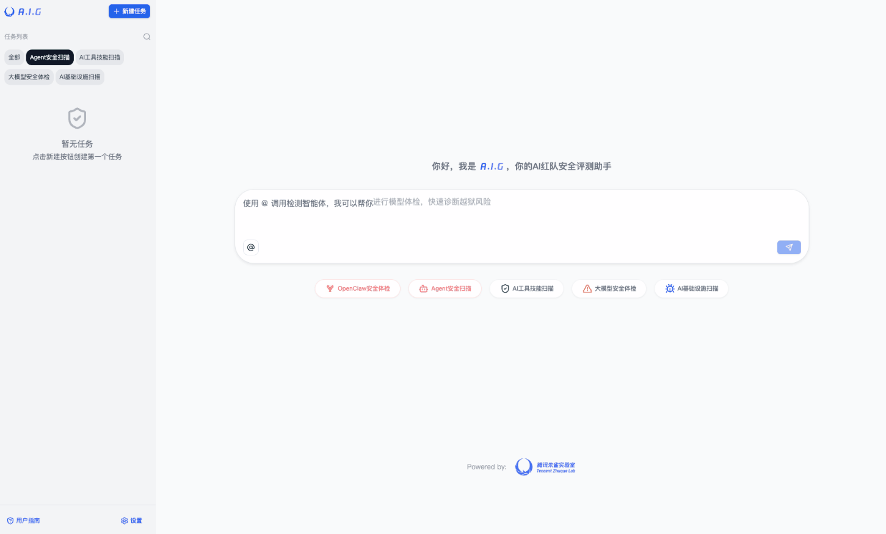
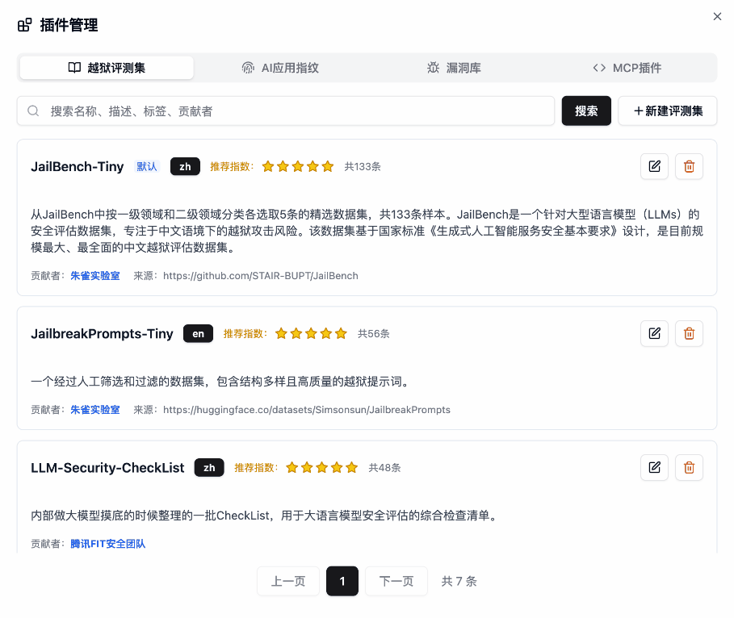

<p align="center">
    <h1 align="center"></h1>
</p>
<p align="center">
  <a href="https://tencent.github.io/AI-Infra-Guard/">📖 文档</a> &nbsp;|&nbsp;
  🌐 <a href="../README.md">🇬🇧 English</a> · <b>🇨🇳 中文</b>
</p>
<p align="center">
    <a href="https://github.com/tencent/AI-Infra-Guard/stargazers">
      
    </a>
    <a href="https://github.com/Tencent/AI-Infra-Guard">
        
    </a>
    <a href="https://github.com/Tencent/AI-Infra-Guard">
        
    </a>
    <a href="https://github.com/Tencent/AI-Infra-Guard">
        
    </a>
</p>
<p align="center">
    <a href="https://clawhub.ai/aigsec/edgeone-clawscan" target="_blank">
       
    </a>
    <a href="https://clawhub.ai/aigsec/edgeone-skill-scanner" target="_blank">
       
    </a>
    <a href="https://clawhub.ai/aigsec/aig-scanner" target="_blank">
       
    </a>
</p>
<p align="center">
    <a href="https://github.com/openclaw/clawscan" target="_blank">
       
    </a>
</p>
<p align="center">
  <a href="https://trendshift.io/repositories/13637" target="_blank"><picture><source media="(prefers-color-scheme: dark)" srcset="https://trendshift.io/api/badge/repositories/13637"><source media="(prefers-color-scheme: light)" srcset="https://trendshift.io/api/badge/repositories/13637"></picture></a>&nbsp;
  <a href="https://www.blackhat.com/eu-25/arsenal/schedule/index.html#aigai-infra-guard-48381" target="_blank"></a>&nbsp;
  <a href="https://github.com/deepseek-ai/awesome-deepseek-integration" target="_blank"></a>
</p>

<br>

<p align="center">
    <h3 align="center">🚀 腾讯朱雀实验室推出的一站式 AI 红队安全测试平台</h3>
</p>

<b>A.I.G (AI-Infra-Guard)</b> 集成OpenClaw安全体检、Agent安全扫描、AI工具技能扫描、AI基础设施漏洞扫描与大模型安全体检（越狱评估）等能力，旨在为用户提供最全面、智能与易用的AI安全风险自查解决方案。

<p>
  我们致力于将A.I.G(AI-Infra-Guard)打造为业界领先的 AI 红队工具平台。更多的 Star 能让这个项目被更多人看到，吸引更多的开发者参与进来，从而让项目更快地迭代和完善。您的 Star 对我们至关重要！
</p>
<p align="center">
  <a href="https://github.com/Tencent/AI-Infra-Guard">
      
  </a>
</p>

<br>


## 目录
- [🚀 快速开始](#-快速开始)
- [🧰 独立调用](#-独立调用)
- [🖼️ 功能展示](#-功能展示)
- [📖 用户指南](#-用户指南)
- [🏗️ 架构演进](../docs/architecture_evolution.md)
- [📝 贡献指南](#-贡献指南)
- [🛡️ 关于团队](#️-关于团队)
- [🙏 致谢](#-致谢)
- [💬 加入社区](#-加入社区)
- [📖 引用](#-引用)
- [📄 开源协议](#-开源协议)

## 🚀 快速开始
### 🐳 使用 Docker 部署 A.I.G

| Docker | 内存 | 磁盘空间 |
|:-------|:----|:----------|
| 20.10 或更高 | 4GB+ | 10GB+ |

```bash
# 此方法会从 Docker Hub 拉取预构建的镜像
git clone https://github.com/Tencent/AI-Infra-Guard.git
cd AI-Infra-Guard
# Docker Compose V2+ 请将 'docker-compose' 替换为 'docker compose'
docker-compose -f docker-compose.images.yml up -d
```

服务启动后，您可以通过以下地址访问 A.I.G 的 Web 界面：
`http://localhost:8088`
<br>


### 其他安装方式

**方式 2：一键安装脚本（推荐）**
```bash
# 此方法将自动安装 Docker 并启动 A.I.G
curl https://raw.githubusercontent.com/Tencent/AI-Infra-Guard/refs/heads/main/docker.sh | bash
```

**方式 3：源码编译运行**
```bash
git clone https://github.com/Tencent/AI-Infra-Guard.git
cd AI-Infra-Guard
# 此方法从本地源代码构建 Docker 镜像并启动服务
# (Docker Compose V2+ 请将 'docker-compose' 替换为 'docker compose')
docker-compose up -d
```

注意：AI-Infra-Guard 项目定位为企业或个人内部使用的 AI 红队测试平台，目前暂无鉴权认证机制，请勿在公网环境中部署使用。

更多信息请参阅：[https://tencent.github.io/AI-Infra-Guard/?menu=getting-started](https://tencent.github.io/AI-Infra-Guard/?menu=getting-started)

</details>

## 🧰 独立调用

五个扫描能力可以不启动 Web 服务，各自安装后在命令行使用。下面只给出最短用法，参数和示例见对应 README。

### AI 基础设施扫描

扫描域名、IP 或 URL，匹配指纹和漏洞。

```bash
pip install aig-infra-scan
aig-infra-scan -t https://example.com
```

[查看 README](../infra-scan/README_zh.md)

### 大模型体检 / 越狱

对兼容 OpenAI 接口的模型做安全评测。

```bash
pip install aig-model-scan
aig-model-scan \
  --model "gpt-4o-mini" \
  --base_url "https://api.openai.com/v1" \
  --api_key "your-api-key" \
  --max_concurrent 10 \
  --scenarios Bias \
  --techniques Raw
```

[查看 README](../AIG-PromptSecurity/README_ZH.md)

### MCP 扫描

扫描 MCP Server 源码目录，或连接一个已经在运行的服务。

```bash
pip install aig-mcp-scan
export LLM_API_KEY="your-api-key"
aig-mcp-scan --repo /path/to/mcp-server -o result.sarif.json
```

[查看 README](../mcp-scan/README_zh.md)

### Skill 扫描

审计本地 Agent Skill 目录。

```bash
pip install aig-skill-scan
export LLM_API_KEY="your-api-key"
aig-skill-scan --repo /path/to/your/skill -o result.sarif.json
```

[查看 README](../skill-scan/README_zh.md)

### Agent 扫描

向正在运行的 Agent 发送测试提示。`target.yaml` 描述被测 Agent，密钥给扫描用的模型。

```bash
pip install aig-agent-scan
export LLM_API_KEY="your-api-key"
aig-agent-scan --agent_provider target.yaml -o result.json
```

[查看 README](../agent-scan/README_zh.md)

## 🖼️ 功能展示

### A.I.G 主界面




<br />

## 📖 用户指南

访问我们的在线文档：[https://tencent.github.io/AI-Infra-Guard/](https://tencent.github.io/AI-Infra-Guard/)

更多详细的常见问题解答和故障排除指南，请访问我们的[文档](https://tencent.github.io/AI-Infra-Guard/?menu=faq)。
<br />
<br>

## 📝 贡献指南

A.I.G 的核心能力之一就是其丰富且可快速配置的插件系统。我们欢迎社区贡献高质量的插件和功能。

### 贡献插件规则
1.  **指纹规则**: 在 `data/fingerprints/` 目录下添加新的 YAML 指纹文件
2.  **漏洞规则**: 在 `data/vuln/` 目录下添加新的漏洞检测规则
3.  **MCP 插件**: 在 `data/mcp/` 目录下添加新的 MCP 安全检测规则
4.  **模型评测集**: 在 `data/eval` 目录下添加新的模型评测集

请参考现有规则格式，创建新文件并通过 Pull Request 提交。

### 其他贡献方式
- 🐛 [报告Bug](https://github.com/Tencent/AI-Infra-Guard/issues)
- 💡 [建议新功能](https://github.com/Tencent/AI-Infra-Guard/issues)
- ⭐ [改进文档](https://github.com/Tencent/AI-Infra-Guard/pulls)
<br />
<br />

## 🛡️ 关于团队

本项目由 <strong>腾讯安全平台部朱雀实验室（Tencent Zhuque Lab）</strong> 主导开发。<a href="https://matrix.tencent.com/">腾讯朱雀实验室</a>是腾讯安全平台部于 2019 年成立的顶尖安全实验室，专注于 AI 安全领域的实战攻防与前沿技术研究，研究方向涵盖大模型安全、AI 智能体安全、AI 赋能安全与 AI 生成检测等领域。

团队多次协助 <strong>英伟达、谷歌、微软</strong> 等知名厂商以及 <strong>OpenClaw、Linux、Hugging Face</strong> 等开源社区修复大量高危漏洞，并获得官方公开致谢。

先后推出开源 AI 红队安全测试平台 <strong>A.I.G（AI-Infra-Guard）</strong> 及 <strong>朱雀 AI 检测助手</strong> 等 AI 安全产品。研究成果广泛发表于 <strong>Black Hat、DEF CON、ICLR、CVPR、NeurIPS、ACL</strong> 等国际顶级安全与 AI 学术会议，并出版专著《AI 安全：技术与实战》。

### 👥 核心成员与贡献

| 角色 | 成员 | 贡献 |
| --- | --- | --- |
| 腾讯安全平台部负责人 | **杨勇** | 发起 A.I.G 项目，并提出"智能体失控风险自动化评估"方向，推动平台从 AI 基础设施漏洞扫描扩展到智能体执行风险、工具滥用和权限边界评估。 |
| 腾讯朱雀实验室负责人 | **郑兴** | 提出自动化漏洞更新与基准对齐机制，推动 AI Infra 指纹、CVE/GHSA 规则与 Benchmark 体系持续迭代。 |
| 项目负责人 | **Nicky** | 负责前沿安全研究、产品规划、技术路线决策、内外部合作与宣发。 |
| 技术负责人 | **Python** | 负责整体架构设计、核心模块研发与版本迭代。 |
| 核心贡献者 | **Zona** | 负责前端交互与产品体验、社区运营及用户反馈闭环。 |
| 核心贡献者 | **Fyoung** | 负责 AI Infra 漏洞组件指纹更新与 Benchmark 体系构建。 |
| 核心贡献者 | **Xiangfan** | 负责 Skill 与 Agent 失控相关安全能力研发。 |
| 核心贡献者 | **Elwood** | 负责 Agent 安全扫描的能力提升与技术报告更新。 |
| 核心贡献者 | **Robert** | 负责大模型安全评估（越狱评测）策略运营。 |
| 核心贡献者 | **Zoe** | 负责大模型安全评估（越狱评测）与模型接入模块研发。 |
| 贡献者 | **Ronin** | 参与 AI 智能体安全扫描研发。 |
| 贡献者 | **Rsin** | 参与社区运营与活动宣发。 |

<br />

## 🙏 致谢

### 🎓 学术合作

感谢以下学术合作伙伴在研究与技术方面的支持与贡献。

#### 
<table>
  <tr>
    <td align="center" width="90">
      <a href="#">
        
      </a>
      <br />
      <a href="#">
        <sub><b>李挥教授</b></sub>
      </a>
    </td>
    <td align="center" width="90">
      <a href="https://github.com/TheBinKing">
        
      </a>
      <br />
      <a href="mailto:1546697086@qq.com">
        <sub><b>王滨</b></sub>
      </a>
    </td>
    <td align="center" width="90">
      <a href="https://github.com/KPGhat">
        
      </a>
      <br />
      <a href="mailto:kpghat@gmail.com">
        <sub><b>刘泽心</b></sub>
      </a>
    </td>
    <td align="center" width="90">
      <a href="https://github.com/GioldDiorld">
        
      </a>
      <br />
      <a href="mailto:g.diorld@gmail.com">
        <sub><b>余昊</b></sub>
      </a>
    </td>
    <td align="center" width="90">
      <a href="https://github.com/Jarvisni">
        
      </a>
      <br />
      <a href="mailto:719001405@qq.com">
        <sub><b>杨傲</b></sub>
      </a>
    </td>
    <td align="center" width="90">
      <a href="https://github.com/Zhengxi7">
        
      </a>
      <br />
      <a href="mailto:linzhengxi7@126.com">
        <sub><b>林郑熹</b></sub>
      </a>
    </td>
  </tr>
</table>

#### 

<table>
  <tr>
    <td align="center" width="120">
      <a href="https://yangzhemin.github.io/">
        
      </a>
      <br />
      <a href="mailto:yangzhemin@fudan.edu.cn">
        <sub><b>杨哲慜教授</b></sub>
      </a>
    </td>
    <td align="center" width="100">
      <a href="https://github.com/kangwei-zhong">
        
      </a>
      <br />
      <a href="mailto:kwzhong23@m.fudan.edu.cn">
        <sub><b>钟康维</b></sub>
      </a>
    </td>
    <td align="center" width="90">
      <a href="https://github.com/MoonBirdLin">
        
      </a>
      <br />
      <a href="mailto:linjp23@m.fudan.edu.cn">
        <sub><b>林佳鹏</b></sub>
      </a>
    </td>
    <td align="center" width="90">
      <a href="https://vanilla-tiramisu.github.io/">
        
      </a>
      <br />
      <a href="mailto:csheng25@m.fudan.edu.cn">
        <sub><b>盛铖</b></sub>
      </a>
    </td>
  </tr>
</table>
<br>

### 👥 感谢以下团队与开发者的贡献
<br />
<table style="border: none; border-collapse: inherit;">
  <tr>
    <td width="33%" style="border: none;"></td>
    <td width="33%" style="border: none;"></td>
    <td width="33%" style="border: none;"></td>
  </tr>
</table>
<a href="https://github.com/Tencent/AI-Infra-Guard/graphs/contributors">
  
</a>
<br>
<br>

### 🤝 感谢以下企业与团队对 A.I.G 的使用与支持

<br>
<div align="center">


</div>

<div align="center">


</div>

<br>

## 💬 加入社区

### 🌐 在线讨论
- **GitHub讨论**：[加入我们的社区讨论](https://github.com/Tencent/AI-Infra-Guard/discussions)
- **问题与Bug报告**：[报告问题或建议功能](https://github.com/Tencent/AI-Infra-Guard/issues)

### 📱 讨论社群
<table>
  <thead>
  <tr>
    <th>微信群</th>
  </tr>
  </thead>
  <tbody>
  <tr>
    <td></td>
  </tr>
  </tbody>
</table>

### 📧 联系我们
如有合作咨询或反馈，请联系我们：[zhuque@tencent.com](mailto:zhuque@tencent.com)

### 🔗 更多安全工具
如果你对代码安全感兴趣，推荐关注腾讯悟空代码安全团队开源的行业首个项目级 AI 生成代码安全性评测框架[A.S.E（AICGSecEval）](https://github.com/Tencent/AICGSecEval)。

<br>
<br>

## 📖 引用

如果您在研究或产品中使用了A.I.G，请使用以下引用：

```bibtex
@misc{Tencent_AI-Infra-Guard_2025,
  author={{Tencent Zhuque Lab}},
  title={{AI-Infra-Guard: A Comprehensive, Intelligent, and Easy-to-Use AI Red Teaming Platform}},
  year={2025},
  howpublished={GitHub repository},
  url={https://github.com/Tencent/AI-Infra-Guard}
}
```
<br>

## 📄 开源协议

本项目基于 **Apache License 2.0** 协议开源。详细信息请查阅 [LICENSE](../LICENSE) 文件。

## ⚖️ 许可与署名规范 (License & Attribution)

本项目采用 **Apache License 2.0** 协议开源。我们非常欢迎并鼓励社区对本项目进行二次开发与集成，但必须遵守以下署名规范：

1. **保留声明**：在您的项目中必须保留源项目中的 `LICENSE` 和 `NOTICE` 文件。
2. **产品露出**：如果您将 AI-Infra-Guard 的核心代码、组件或扫描引擎集成到您的开源项目、商业产品或内部平台中，必须在您的**产品文档、使用说明或 UI 的「关于」页面**中，明确标明：
   > "本项目集成了由腾讯朱雀实验室开源的 [AI-Infra-Guard](https://github.com/Tencent/AI-Infra-Guard) 项目。"
3. **学术与文章引用**：如果在漏洞分析报告、安全研究文章、学术论文等公开材料中使用了本工具，请明确提及"腾讯朱雀实验室 AI-Infra-Guard"并附上链接。

严禁在隐匿原始出处的情况下，将本项目重新包装为原创产品发布。

<div>

<a href="https://www.star-history.com/?type=date&repos=Tencent%2FAI-Infra-Guard">
 <picture>
 <source media="(prefers-color-scheme: dark)" srcset="https://api.star-history.com/chart?repos=Tencent/AI-Infra-Guard&type=date&theme=dark&legend=top-left&sealed_token=3aux6V5PKs5SBSuoVgw6MReXo5IzleLoV22UkaLZtWuN6kK4PltQDiq-hrtHpF4smNRGO9dbhrjk9Q4m7FWsPPUQqIsQUUrZkwev7vTDanFVCAHfU1qusQ" />
 <source media="(prefers-color-scheme: light)" srcset="https://api.star-history.com/chart?repos=Tencent/AI-Infra-Guard&type=date&legend=top-left&sealed_token=3aux6V5PKs5SBSuoVgw6MReXo5IzleLoV22UkaLZtWuN6kK4PltQDiq-hrtHpF4smNRGO9dbhrjk9Q4m7FWsPPUQqIsQUUrZkwev7vTDanFVCAHfU1qusQ" />
 
 </picture>
</a>
